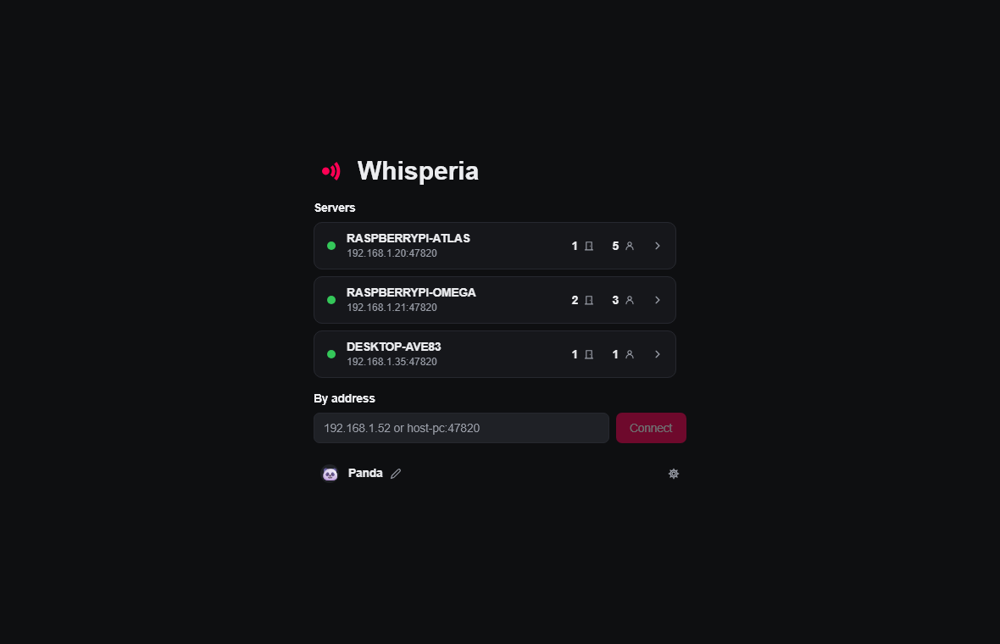
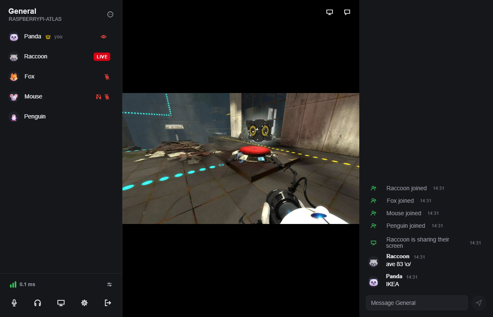
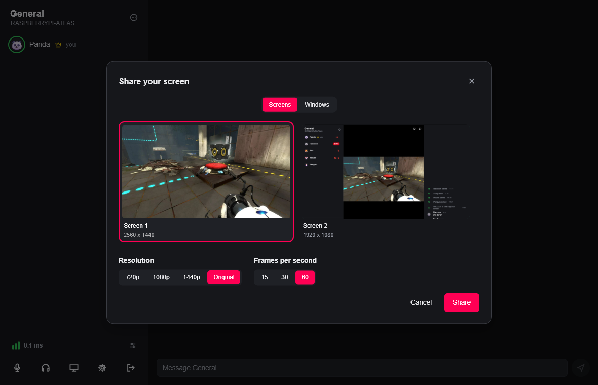

# Whisperia

A self hosted voice chat with screen sharing. The point of the project is to be light: the client is a native program rather than a browser in a window and is meant to take as little RAM as it can, the server only forwards what it gets.

What it does:

- Voice with noise suppression on the microphone: DeepFilterNet3, or RNNoise as the lighter one.
- Sharing a screen or a window with its sound, in its own resolution with no limit or scaled down, at up to 60 FPS.
- A basic text chat: plain messages for whoever is in the room at the moment, with no history.
- No accounts, and nothing is kept anywhere: a room exists while somebody is in it.
- On a local network the server shows up in the client by itself.

Memory it takes:

| Client                                       | RAM     |
|----------------------------------------------|---------|
| Started, in the list of servers              | ~110 MB |
| In a call, window open or hidden in the tray | ~110 MB |
| In a call with noise suppression off         | ~100 MB |
| Sharing a 2560x1440 screen at 60 FPS         | ~150 MB |
| Watching a 2560x1440 screen at 60 FPS        | ~170 MB |

| Server                                                      | RAM   |
|-------------------------------------------------------------|-------|
| Windows, five people in a room, one of them sharing 1440p60 | ~4 MB |
| Docker on a Raspberry Pi, waiting                           | ~2 MB |







## Requirements

Client:

- Windows 10 2004 or newer.
- Sharing a screen needs a video card with a hardware H.264 encoder, watching one needs Direct3D 12.

Server:

- Windows or Linux, or anything that runs Docker.
- Inbound UDP on the server port (47820 by default).
- The same version as the clients.

## Client

Download `whisperia-client-<version>-windows-x64-setup.exe` from the [latest release](https://github.com/jagerente/whisperia/releases/latest) and run it: it installs Whisperia for your user, without administrator rights, into `%LOCALAPPDATA%\Programs\Whisperia`, and a newer one updates it in place, closing Whisperia if it is running. Allow Whisperia when the firewall asks. Servers on the local network show up by themselves, any other one is added by its address.

| Option                 |                                                                                                     |
|------------------------|-----------------------------------------------------------------------------------------------------|
| `--settings-dir <DIR>` | keep settings and the log in this folder; a copy started with its own folder runs next to the other |
| `--fake-audio`         | a test tone instead of the microphone                                                               |
| `--hidden`             | start in the tray, without the window; with no tray the window opens anyway                         |

Without `--settings-dir`, settings are in `%APPDATA%\whisperia\config` and the log is `%LOCALAPPDATA%\whisperia\data\client.log`. Uninstalling keeps them unless you tick "Delete my settings and the log too".

## Server

On Windows, download `whisperia-server-<version>-windows-x64.zip` from the [latest release](https://github.com/jagerente/whisperia/releases/latest), unpack it and start `whisperia-server.exe`. On Linux, use the [Docker image](#docker). Everything in the table is optional.

| Option             | Env var                    | Default          |                                                            |
|--------------------|----------------------------|------------------|------------------------------------------------------------|
| `--name`           | `WHISPERIA_NAME`           | computer name    | name in the clients' server list                           |
| `--port`           | `WHISPERIA_PORT`           | 47820            | UDP port                                                   |
| `--bind`           | `WHISPERIA_BIND`           | 0.0.0.0          | address to listen on                                       |
| `--password`       | `WHISPERIA_PASSWORD`       | none             | password clients must enter                                |
| `--max-peers`      | `WHISPERIA_MAX_PEERS`      | 16               | max clients at once                                        |
| `--no-advertise`   | `WHISPERIA_NO_ADVERTISE`   | false            | don't announce over mDNS, clients type the address         |
| `--advertise-addr` | `WHISPERIA_ADVERTISE_ADDR` | own addresses    | IPv4 addresses to announce instead, for VMs and containers |
| `--data-dir`       | `WHISPERIA_DATA_DIR`       | user data folder | where the certificate lives; delete it for a new identity  |

The user data folder is `~/.local/share/whisperia/server` on Linux and `%LOCALAPPDATA%\whisperia\data\server` on Windows; in Docker it is `/data`, kept in a volume. `RUST_LOG` sets log detail.

### Docker

The image is [`ghcr.io/jagerente/whisperia`](https://github.com/jagerente/whisperia/pkgs/container/whisperia), for amd64 and arm64. `latest` is the latest release, a version tag such as `1.0.0` keeps the server at the clients' version, `edge` follows `main`.

With compose, settings go under `environment:` in `compose.yaml`:

```
curl -O https://raw.githubusercontent.com/jagerente/whisperia/main/compose.yaml
docker compose up -d
```

Or on its own:

```
docker run -d --name whisperia --network host --restart unless-stopped -v whisperia:/data -e WHISPERIA_NAME=Home ghcr.io/jagerente/whisperia
```

To update: `docker compose pull && docker compose up -d`, or pull and start the container again.

The container uses the host's network, so the server is found on the local network as without Docker. A host firewall needs UDP 47820 and 5353 (mDNS) open. This doesn't work with Docker Desktop, whose host network is a VM: there clients type the address.

## Stack

- Rust, both the client and the server.
- [Slint](https://slint.dev) for the window, drawn by Skia on wgpu over Direct3D 12, or by Slint's software renderer where Direct3D 12 does not start.
- QUIC ([quinn](https://github.com/quinn-rs/quinn)) for everything on the network, a self-signed certificate ([rcgen](https://github.com/rustls/rcgen)) that the client pins on first use, mDNS ([mdns-sd](https://github.com/keepsimple1/mdns-sd)) to find servers on the local network.
- Sound through WASAPI ([cpal](https://github.com/RustAudio/cpal)), voice in [Opus](https://opus-codec.org).
- Noise suppression with [DeepFilterNet3](https://github.com/Rikorose/DeepFilterNet) run by [tract](https://github.com/sonos/tract), or RNNoise ([nnnoiseless](https://github.com/jneem/nnnoiseless)) as the lighter one.
- Screen capture with Windows.Graphics.Capture, H.264 on the video card's encoder (NVENC, AMF, Quick Sync) through Media Foundation, decoded on DXVA. Frames stay in Direct3D textures shared with the window, the processor never copies them.
- The sound of a shared window or screen through WASAPI process loopback.
- Link previews from the Open Graph tags of the page, fetched by the client with [ureq](https://github.com/algesten/ureq).
- The server only forwards what it gets to the rest of the room and never decodes anything. It runs on [tokio](https://tokio.rs) and does not depend on any audio or video library.
